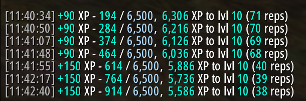
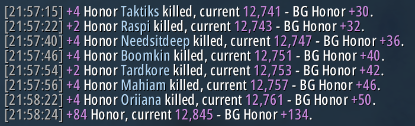
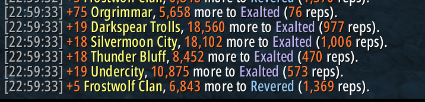
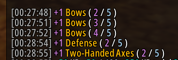

# uGain

A lightweight, unified World of Warcraft addon for WoW Classic (Era/SoD), TBC, Wrath, and Cataclysm that replaces default combat/chat gain messages with clean, formatted, and color-coded notices.

## Features

- **uXp**: Formatted XP gains with current progress, remaining XP to next level, and estimated repetitions needed.
- **uHonor**: Honor gains with current total, rank info, and cumulative battleground session honor tracking.
- **uRep**: Reputation changes with formatted amounts, remaining rep to next standing, and repetitions needed.
- **uSkill**: Skill point advancement notifications with current and maximum points.
- **uCurrency**: Money gains and losses formatted with gold, silver, and copper.
- **uLoot**: Looted item gains with total inventory count, stacks occupied, and free/total bag slots. Also adds max stack size to stackable item tooltips.

## Configuration & Options

Open the Blizzard Interface Options panel or use slash commands in chat:

```
/ugain           - Open settings panel
/ugain status    - Display current toggle status for all modules
/ugain <module>  - Toggle a module (xp, honor, bghonor, rep, skill, currency, loot)
/ugain help      - Display available slash commands
```

Disabling any module will automatically unfilter Blizzard's default chat message and stop uGain notifications for that category.

## Screenshots

### XP Gain


### Honor Gain


### Reputation Gain


### Skill Gain
